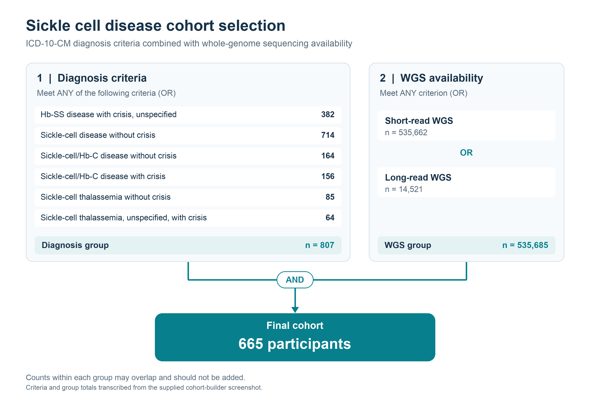
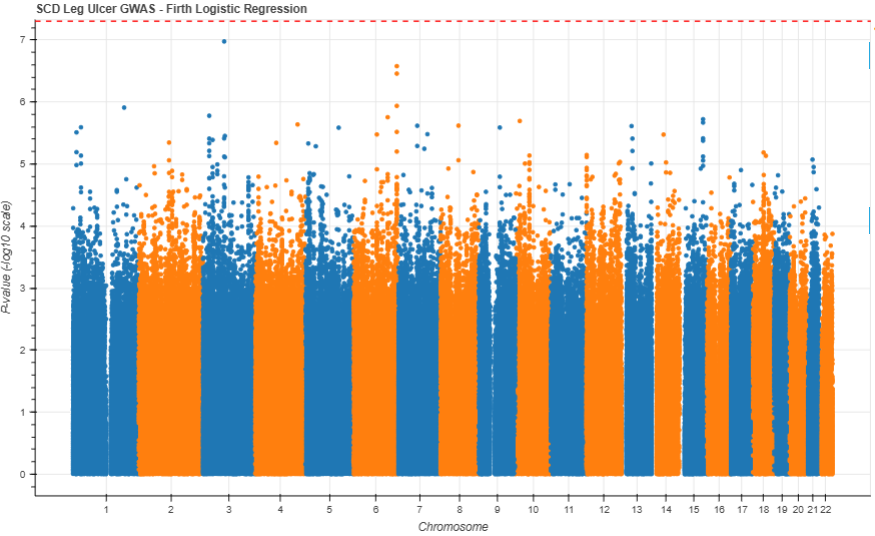
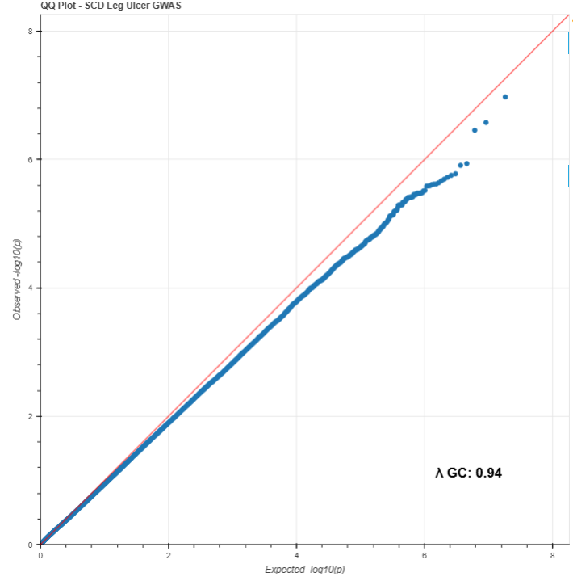

# Sickle Cell Disease and Leg Ulcer GWAS

This project investigates genetic variants associated with leg ulcer status in participants with sickle cell disease (SCD), using whole-genome sequencing (WGS) and covariate-adjusted Firth logistic regression.

The selected cohort contains **665 participants: 38 cases and 627 controls**. The reported analysis includes **18,273,532 variants**. No variants reached genome-wide significance (`P < 5e-8`); **77 variants** met the suggestive threshold (`P < 1e-5`).

## Contents

- [Cohort and phenotype](#cohort-and-phenotype)
- [Variant filtering and PCA preparation](#variant-filtering-and-pca-preparation)
- [Association analysis](#association-analysis)
- [Results](#results)
- [Data locations](#data-locations)
- [Documentation and reproducibility](#documentation-and-reproducibility)

## Cohort and phenotype

Participants were required to meet at least one qualifying ICD-10-CM diagnosis criterion for SCD **and** have short-read or long-read WGS data available. Diagnosis criteria were combined using OR; sequencing availability criteria were also combined using OR.



The diagnosis group contained 807 participants, and the WGS availability group contained 535,685 participants. Their intersection contained 665 participants. Counts within each group overlap and should not be summed.

### Phenotype coding

| Phenotype | Coding | Participants |
| --- | --- | ---: |
| Leg ulcer case | `PHENOTYPE = 1` | 38 |
| Control | `PHENOTYPE = 0` | 627 |
| Total selected cohort | | 665 |

The exact clinical criteria and observation window used to assign leg ulcer status remain to be documented.

### Participant characteristics

| Characteristic | Overall (N = 665), n (%) |
| --- | --- |
| Age, years |  |
| 18–45 | 281 (42.3) |
| 45–65 | 230 (34.6) |
| ≥65 | 123 (18.5) |
| Unknown | 31 (4.7) |
| Sex at birth |  |
| Female | 445 (66.9) |
| Male | 210 (31.6) |
| Prefer not to answer | 1 (0.2) |
| Skipped | 9 (1.4) |
| Race |  |
| American Indian or Alaska Native | 9 (1.4) |
| Asian | 2 (0.3) |
| Black or African American | 468 (70.4) |
| Middle Eastern or North African | 2 (0.3) |
| More than one population | 38 (5.7) |
| None indicated | 71 (10.7) |
| Prefer not to answer | 10 (1.5) |
| Categories pending verification | 65 (9.8) |
| Leg ulcer status |  |
| Case | 38 (5.7) |
| Control | 627 (94.3) |

Percentages use the selected cohort size of 665 and may not sum to 100% because of rounding. Age categories are reproduced as displayed in the source; exact interval boundaries should be confirmed. Race categories for 65 participants remain pending verification.

**Selected cohort versus analysis cohort:** the GWAS script retains participants with complete phenotype and covariate data and requires their IDs to match the genotype data. The final analyzed sample size and case/control counts must be confirmed from the run logs; they may differ from the selected cohort above.

## Variant filtering and PCA preparation

### GWAS variant filters

| Criterion | Threshold |
| --- | --- |
| Alleles | Biallelic variants |
| Variant types | SNPs and indels |
| Minor allele frequency | MAF ≥1% |
| Genotype call rate | ≥85% |
| Genotype missingness | ≤15% |

MAF and call rate were recalculated in the final analysis cohort. These are variant-level filters. The GWAS script does not apply LD pruning to the association-testing variant set.

### PCA preparation

A separate, more stringent set of filters was used in the PCA preparation script:

| Criterion | Setting |
| --- | --- |
| Variant filter status | PASS |
| Variant type | Biallelic SNPs |
| Genotype eligibility | Defined, diploid calls |
| Variant call rate | ≥98% |
| Minor allele frequency | MAF ≥5% |
| Excluded MHC region | chr6:25,000,000–34,000,000 |
| Excluded HBB region | chr11:4,000,000–6,000,000 |
| LD pruning | R2 = 0.2 |
| LD window | 500 kb |

The supplied PCA preparation script covers chromosomes 2–21. Confirm the chromosome coverage of the final PCA input and the reference assembly used for the excluded intervals.

## Association analysis

Associations were tested using **Firth logistic regression in Hail**, with binary leg ulcer status as the outcome and alternative-allele count as the genotype predictor under an additive model.

The age-adjusted model includes an intercept and the following covariates:

- Sex
- Age
- Genetic principal components PC1–PC3
- Hydroxyurea use

```text
logit[P(leg ulcer = 1)] = intercept + genotype + sex + age
                        + PC1 + PC2 + PC3 + hydroxyurea use
```

Firth correction addresses small-sample bias and separation. The supplied implementation uses `hl.logistic_regression_rows(test="firth", ...)` and reads covariates from `SCD_GWAS_covar_HU_withAge.tsv`.

Effect estimates are reported as log odds ratios (`beta`) and odds ratios (`OR = exp(beta)`) for the alternative allele. The script records convergence status, iteration count, and whether a fit exploded. These fields should be checked before finalizing summaries.

## Results

### Summary

| Measure | Reported result |
| --- | ---: |
| Total variants | 18,273,532 |
| Minimum P value | 1.0594e-7 |
| Genome-wide significant variants (`P < 5e-8`) | 0 |
| Suggestive variants (`P < 1e-5`) | 77 |
| Genomic inflation factor (lambda GC), as shown in the QQ plot | 0.94 |

No variants reached the genome-wide significance threshold. Suggestive associations require further investigation and independent replication. The 77 variants may include correlated associations and do not necessarily represent 77 independent loci.

### Top reported associations

| Chromosome | Position | REF → ALT | P value | Beta | OR | ALT frequency | MAF |
| --- | --- | --- | --- | --- | --- | --- | --- |
| chr3 | 80,829,537 | C → CT | 1.06 × 10⁻⁷ | 2.41 | 11.10 | 0.0561 | 0.0561 |
| chr6 | 164,394,839 | C → T | 2.65 × 10⁻⁷ | 1.41 | 4.09 | 0.301 | 0.301 |
| chr6 | 164,394,840 | T → C | 3.50 × 10⁻⁷ | 1.40 | 4.05 | 0.302 | 0.302 |
| chr6 | 164,394,784 | C → G | 1.16 × 10⁻⁶ | 1.30 | 3.65 | 0.307 | 0.307 |
| chr1 | 193,193,780 | A → AGTGT | 1.23 × 10⁻⁶ | 2.14 | 8.47 | 0.0385 | 0.0385 |

Positions and values are reproduced from the analysis document. Confirm the reference genome assembly before variant annotation. Reported beta and OR values are rounded separately.

### Manhattan plot



The plot displays `-log10(P)` across chromosomes 1–22. The red dashed line marks the genome-wide significance threshold of `P = 5e-8`. No reported association exceeds this threshold.

### QQ plot



The plot compares observed and expected `-log10(P)` values. The displayed lambda GC is 0.94, indicating a mildly conservative test-statistic distribution; this does not by itself establish absence of confounding.

## Data locations

The following Google Cloud Storage paths refer to analysis workspace data. Access requires appropriate credentials and bucket permissions.

| Resource | Location |
| --- | --- |
| Summary statistics and analysis outputs | `gs://sicklecell-icd-wgs-wb-rapid-grape-7347/gwas/results/` |
| Chromosome-specific Hail MatrixTables | `gs://sicklecell-icd-wgs-wb-rapid-grape-7347/gwas/mt_n665/` |
| Phenotype and covariate inputs | `gs://sicklecell-icd-wgs-wb-rapid-grape-7347/gwas/input/` |
| Pre-PCA preparation (prune and filter) | `gs://sicklecell-icd-wgs-wb-rapid-grape-7347/gwas/pca_n665/`|
### Input files

| File | Description |
| --- | --- |
| phenotype_leg_ulcer_n665.csv | Binary leg ulcer phenotype for 665 participants: 38 cases and 627 controls |
| SCD_GWAS_covar_HU_withAge.tsv | Covariates |
| SCD_665_EHR_dates.csv | Electronic health record date information |

## Documentation and reproducibility

This README and its figures describe the reported analysis. They do not include participant-level data or an executable analysis pipeline.

```text
README.md
assets/
  cohort-selection.png
  manhattan-plot.png
  qq-plot.png
```

The analysis uses Python, Hail/Spark, NumPy, pandas, and Google Cloud CLI (`gsutil`). The supplied progress-monitoring implementation also uses `requests` and `tqdm`. Exact package versions and runtime configuration have not yet been recorded here.

To complete reproducibility documentation:

- [ ] Link the phenotype-generation, PCA, GWAS, and plotting scripts or notebooks.
- [ ] Record the Git commit and software versions used for the reported analysis.
- [ ] Document leg ulcer case/control definitions, age derivation, sex coding, and hydroxyurea exposure coding.
- [ ] Confirm the final analyzed sample size and case/control counts after exclusions.
- [ ] Resolve the remaining race categories and age interval boundaries.
- [ ] Record the reference genome assembly and chromosome coverage of the final PCA dataset.
- [ ] Identify the exact per-chromosome result files used for the combined results and plots.
- [ ] Document handling of failed or non-converged regression fits.
